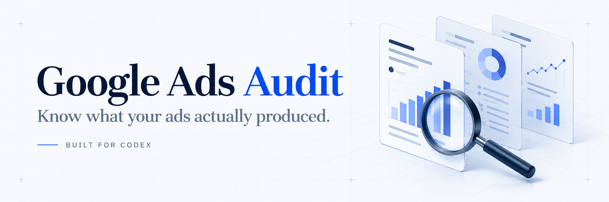
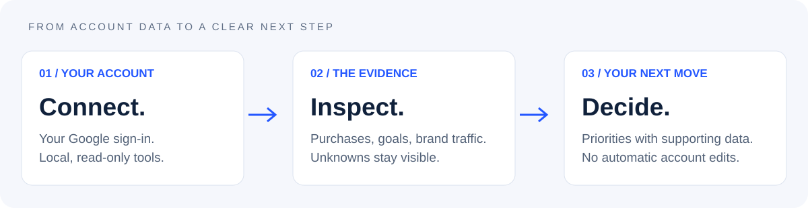

<strong>Read-only tools · Purchase-aware reporting · Your own Google account</strong>

<a href="#start-with-one-prompt">Get started</a> · <a href="examples/illustrative-audit.md">See an example</a> · <a href="SETUP.md">Setup guide</a> · <a href="https://israelseofreelancer.com/">Work with Zechariah</a>

# A clearer answer to “what did my ads actually produce?”

Google Ads can show purchases, calls, cart events and page views in the same account. A healthy-looking total can hide the distinction. Brand traffic can also make the overall return look stronger than the rest of the account.

This workflow gives Codex the tools and instructions to inspect your Google Ads account, separate those outcomes, and produce an audit with evidence, priorities and visible limitations. **It reads the account. It does not change campaigns or spend money.**

Built by [Zechariah Tokar](https://israelseofreelancer.com/), an independent search visibility consultant. Uses [Google's official Google Ads MCP server](https://github.com/googleads/google-ads-mcp). This is an independent project, not an official Google or OpenAI product.

## Start with one prompt

Give Codex this repository link and paste:

> Set up the Google Ads audit workflow from https://github.com/ztokar/google-ads-audit on my computer. Read AGENTS.md and SETUP.md, handle the technical setup, and guide me through my own Google sign-in and permissions. List the accounts I can access, then audit the account I select without changing it. Separate purchases from calls and other events, identify brand traffic where possible, and explain what attribution evidence is missing.

Codex handles the terminal work. You complete Google sign-in, identity checks and permission approvals. Setup requires a local Codex environment with terminal access and your own Google Cloud/API setup; it is not a one-click connection.

## What the audit answers

| Your question | What the workflow checks |
|---|---|
| Are these conversions actually purchases? | Conversion actions, primary versus secondary events, and the goals each campaign uses. |
| Is brand carrying the reported return? | Identifiable own-brand traffic across campaigns, with hidden-term limitations disclosed. |
| Where is the traffic poorly matched? | Search terms, keywords, negative lists and the business's actual offer. |
| What needs attention before more spending? | Purchase evidence, campaign settings, bidding, assets and a prioritized action plan. |
| How much can we trust the result? | Query coverage, conversion lag, failed checks and evidence that still needs independent verification. |

The default audit covers the last 90 complete days in the account's time zone. Ask for another period, a purchase-only review, a lead-quality check, or a specific campaign investigation.

## See the difference in the report

**Illustrative example only. These are fictional numbers, not client results.**

| Demo measure | Account-wide | After identifiable brand removal |
|---|---:|---:|
| Spend | $2,400 | $2,000 |
| Purchase credits | 40 | 12 |
| Purchase conversion value | $7,200 | $2,100 |
| Reported purchase ROAS | 3.00x | 1.05x |

The same fictional account has **220 total conversion events**, including 20 calls and 160 cart events. That does not mean 220 sales. The example shows why separating outcomes matters before deciding what to fund.

[Read the full illustrative audit →](examples/illustrative-audit.md)

## What you receive

An audit report with campaign performance, purchase and lead distinctions, targeting and traffic findings, a provisional score with evidence coverage, and a 30-day action plan. Raw query evidence stays locally available for review.

**Ads attribution is not proof of paid sales.** Matching purchase credits to unique paid orders requires separately authorized store or CRM data. Zero conversions do not automatically prove broken tracking. Non-converting clicks are not automatically wasted spend. Hidden search terms cannot be assumed non-brand, and attributed revenue is not proof the ads caused new sales.

## Want help with your setup or audit?

Use the workflow yourself, or talk to me if you want help connecting it, interpreting the evidence, or deciding what to investigate next.

**[Work with Zechariah →](https://israelseofreelancer.com/)**

I work directly with businesses on search visibility, ecommerce pages and practical AI workflows. Bring your account question, your website and what a useful outcome would look like.

## Your data stays under your control

- Use your own Google project and account access. Never borrow another user's credentials.
- The server exposes account listing, metadata and reporting tools. No campaign-editing tool is included in the pinned server.
- Google OAuth permissions are broader than reading, so protect the credentials even though this workflow only reads.
- Credentials live outside the repository. Reports, virtual environments and common credential filenames are excluded from Git.
- Sharing a repository does not share your login. Never upload client reports or account exports to a public issue.

For security concerns, follow [SECURITY.md](SECURITY.md). Please do not post a credential or private customer data in an issue.

<strong>Technical details and validation</strong>

Python 3.11+ and Git are required. Scripts support Windows, macOS and Linux paths. [SETUP.md](SETUP.md) explains the Google access steps, dedicated credentials, optional Codex MCP registration and the local query runner. No separate OpenAI API key is required by these scripts; normal Codex usage and Google's account/API requirements still apply.

The official server is pinned to upstream commit `9a78cbdceebae71a6bc8483bdec333695834ef9c` (version 0.0.5). Review the current upstream documentation before upgrading. This repository does not vendor Google's server.

The package passed query-generation and credential-isolation tests, a local Windows dependency installation/check, and a server handshake exposing the three expected read-only tools. Each new user must verify their own login and selected account before calling setup complete. Mac/Linux path support has not been validated on fresh installations.

References: [Official server](https://github.com/googleads/google-ads-mcp) · [Google Ads API access levels](https://developers.google.com/google-ads/api/docs/access-levels) · [Codex MCP](https://developers.openai.com/codex/mcp/).

